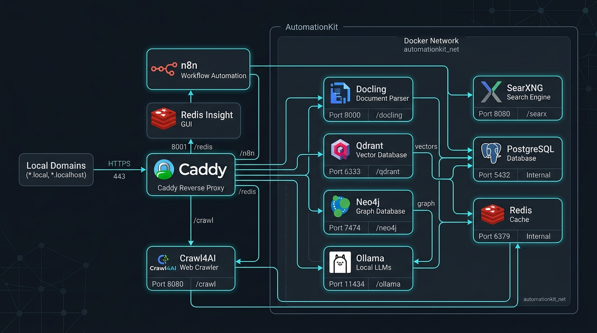

<div align="center">

# ⚡ AutomationKit

### The Production-Grade Local AI Orchestration & Microservices Cloud Stack

<p align="center">
  <a href="https://github.com/codeXparadise/AutomationKit/blob/main/LICENSE"></a>
  <a href="https://github.com/codeXparadise/AutomationKit"></a>
  <a href="https://github.com/codeXparadise/AutomationKit/stargazers"></a>
  <a href="https://github.com/codeXparadise/AutomationKit/issues"></a>
  <a href="https://github.com/codeXparadise/AutomationKit/pulls"></a>
</p>

<p align="center">
  <strong>AutomationKit</strong> is a turn-key, self-hosted developer platform that packages leading workflow automation, local LLMs, vector search, web scraping, document OCR, graph databases, and caching into a unified Docker network orchestrated behind a smart Caddy gateway.
</p>

<p align="center">
  <a href="#-quickstart-guide">Quickstart</a> •
  <a href="#-architecture--networking">Architecture</a> •
  <a href="#-service-matrix--endpoints">Service Matrix</a> •
  <a href="#-n8n-node-integration-blueprints">n8n Blueprints</a> •
  <a href="#-local-swagger--api-docs">Swagger & API Docs</a> •
  <a href="#-contributing--license">Contributing</a>
</p>

---

</div>

## 🎬 Workflow Automation Demo

AutomationKit runs n8n natively integrated with local Ollama models, Qdrant vector retrieval, PostgreSQL state storage, and Crawl4AI scrapers:

<div align="center">
  
</div>

---

## 🏛 Architecture & Networking

All 11 microservices run inside an isolated Docker bridge network (`automationkit`), proxied through the **AutomationKit** Caddy gateway. Local `.local` domains and native `.localhost` fallback domains provide instant browser access with zero SSL warnings or port gymnastics.

<div align="center">
  
</div>

### 🔑 Key Architectural Highlights
* **Zero-Collision Auto-Auth Gateway:** Caddy acts as the front door (`container_name: AutomationKit`), transparently injecting Bearer tokens to backend APIs (such as Crawl4AI Swagger & ReDoc) to eliminate `401 Unauthorized` prompts on direct browser navigation.
* **Persistent Data Separation:** Container states live under `./data/{service}`, persistent cross-container file shares live in `./shared`, and custom configurations reside in `./config`. Recreating containers never loses user workflows or databases.
* **External Task Runner Model:** n8n leverages dedicated task runners with pre-installed Python data science libraries (`pandas`, `numpy`, `yt-dlp`, `redis`, `requests`) isolated from the main orchestration engine.

---

## 🧰 The Technology Stack

| Technology | Role | Version | Official Documentation |
| :--- | :--- | :--- | :--- |
|  **n8n** | Workflow Automation & AI Agents | `v2.43.7` | [docs.n8n.io](https://docs.n8n.io/) |
|  **Redis Insight** | Cache & Queue Visual GUI | `Latest` | [redis.io/insight](https://redis.io/insight/) |
|  **Crawl4AI** | Async Web Crawler & LLM Parser | `Latest` | [crawl4ai.com](https://crawl4ai.com/) |
|  **Qdrant** | Vector Search Engine & RAG DB | `v1.19.2` | [qdrant.tech/documentation](https://qdrant.tech/documentation/) |
|  **Neo4j** | Graph Database & Knowledge Graphs | `5-community` | [neo4j.com/docs](https://neo4j.com/docs/) |
|  **Docling** | Document Parsing & PDF OCR | `Latest` | [ds4sd.github.io/docling](https://ds4sd.github.io/docling/) |
|  **SearXNG** | Private Metasearch Engine | `Latest` | [docs.searxng.org](https://docs.searxng.org/) |
|  **Ollama** | Local LLMs (Llama 3, Mistral, Qwen) | `Latest` | [ollama.com/library](https://ollama.com/library) |
|  **PostgreSQL** | Relational SQL Storage | `16-alpine` | [postgresql.org/docs](https://www.postgresql.org/docs/16/) |
|  **Redis** | In-Memory Key-Value Store | `7-alpine` | [redis.io/docs](https://redis.io/docs/) |
|  **n8n Assistant Sandbox** | Isolated DinD Code Execution Sandbox | `v1.9.0` | [docs.n8n.io](https://docs.n8n.io/deploy/host-n8n/configure-n8n/set-up-n8n-assistant/) |
|  **Caddy** | Reverse Proxy & Portal Host | `2-alpine` | [caddyserver.com/docs](https://caddyserver.com/docs/) |

---

## 🚀 Quickstart Guide

### 1. Prerequisites
* **Docker & Docker Compose v2+**: Installed and running ([Docker Desktop](https://www.docker.com/products/docker-desktop/)).
* **Git**: Installed.
* **Operating System**: Windows (PowerShell/CMD), Linux, or macOS.

### 2. Clone the Repository
```bash
git clone https://github.com/codeXparadise/AutomationKit.git
cd AutomationKit
```

### 3. Configure Secrets (`.env`)
Copy the template configuration file:
```bash
# Windows (CMD)
copy .env.example .env

# Linux / macOS / PowerShell
cp .env.example .env
```
Open `.env` and set your preferred secrets. The default configured test credentials are:
* `POSTGRES_USER=admin`
* `POSTGRES_PASSWORD=295517vp`
* `REDIS_PASSWORD=295517vp`
* `QDRANT_API_KEY=admin:295517vp`
* `CRAWL4AI_API_TOKEN=295517vp`
* `NEO4J_PASSWORD=295517vp`

### 4. Setup Local DNS Domains (Windows)
Run the automated self-elevating setup script to map `.local` domains into your Windows hosts file:
```cmd
setup-hosts.bat
```
*(On Linux/macOS, append the entries in `scripts/add-local-domains.ps1` to `/etc/hosts` if you wish to use `.local` names. Otherwise, `.localhost` works natively in modern browsers without any host configuration).*

### 5. Launch AutomationKit
Start the entire stack using the automated update and start script:
```cmd
start.bat
```
Or directly via Docker Compose:
```bash
docker compose pull
docker compose up -d
```

### 6. Launch the Master Hub Portal
Once running, double-click **`open-hub.bat`** or navigate to:
👉 **[http://localhost](http://localhost)** *(or [http://hub.local](http://hub.local))*

---

## 📊 Service Matrix & Endpoints

| Service | Browser Access (`.local` / Host) | Fallback (`.localhost`) | Docker Internal Host | Default Credentials |
| :--- | :--- | :--- | :--- | :--- |
| **AutomationKit Hub** | `http://localhost` / `http://hub.local` | `http://hub.localhost` | `caddy:80` | None |
| **n8n Automation** | `http://n8n.local` / `http://localhost:5678` | `http://n8n.localhost` | `n8n:5678` | Self-register owner on first boot |
| **Redis Insight** | `http://radis.local` / `http://localhost:5540` | `http://redis.localhost` | `redisinsight:5540` | Host: `redis`, Port: `6379`, Pass: `295517vp` |
| **Crawl4AI Playground** | `http://crawl.local/playground/` | `http://crawl.localhost/playground/` | `crawl4ai:11235` | Bearer Token: `295517vp` |
| **Qdrant Dashboard** | `http://qdrant.local` / `http://localhost:6333/dashboard` | `http://qdrant.localhost` | `qdrant:6333` | API Key: `admin:295517vp` |
| **Neo4j Browser** | `http://neo.local` / `http://localhost:7474` | `http://neo.localhost` | `bolt://neo4j:7687` | User: `neo4j`, Password: `295517vp` |
| **SearXNG Search** | `http://search.local` / `http://localhost:8080` | `http://search.localhost` | `searxng:8080` | None (Open) |
| **Docling Parser UI** | `http://docling.local` / `http://localhost:5001/ui` | `http://docling.localhost` | `docling:5001` | API Key: `295517vp` |
| **Assistant Sandbox API** | `http://sandbox.local` / `http://localhost:5681` | `http://sandbox.localhost` | `sandbox-api:8080` | Header: `X-Api-Key: 295517vp` |
| **Ollama Local LLM** | `http://ollama.local` / `http://localhost:11434` | `http://ollama.localhost` | `ollama:11434` | None (Open) |
| **PostgreSQL DB** | `localhost:5432` *(External SQL clients)* | N/A | `postgres:5432` | User: `admin`, Pass: `295517vp`, DB: `n8n_database` |
| **Redis Store** | `localhost:6379` *(External Redis clients)* | N/A | `redis:6379` | Password: `295517vp` |
| **Shared Volume** | `http://files.local` | `http://files.localhost` | Mount: `/data/shared` | Local folder: `./shared` |

---

## ⚡ n8n Node Integration Blueprints

When building workflows inside n8n, use these connection parameters in your node credentials:

### 1. PostgreSQL Node
* **Host:** `postgres`
* **Port:** `5432`
* **Database:** `n8n_database`
* **User:** `admin`
* **Password:** `295517vp`
* **SSL:** `disable`

### 2. Redis Node
* **Host:** `redis`
* **Port:** `6379`
* **Password:** `295517vp`
* **SSL:** `false`

### 3. Qdrant Vector Store Node
* **Qdrant API URL:** `http://qdrant:6333`
* **API Key:** `admin:295517vp`

### 4. Neo4j Graph Database Node
* **Bolt URL:** `bolt://neo4j:7687`
* **Username:** `neo4j`
* **Password:** `295517vp`

### 5. Crawl4AI (HTTP Request Node)
* **Method:** `POST`
* **URL:** `http://crawl4ai:11235/crawl`
* **Headers:**
  * `Authorization`: `Bearer 295517vp`
  * `Content-Type`: `application/json`
* **JSON Body:**
```json
{
  "urls": ["https://example.com"],
  "crawler_config": {
    "cache_mode": "BYPASS"
  }
}
```

### 6. SearXNG Search (HTTP Request Node)
* **Method:** `GET`
* **URL:** `http://searxng:8080/search`
* **Query Parameters:**
  * `q`: `{{$json.query}}`
  * `format`: `json`

### 7. Ollama Chat & Model Node
* **Base URL:** `http://ollama:11434`
* **Model Name:** `llama3.2` *(pull via `docker exec -it ollama ollama run llama3.2`)*

---

## 📖 Local Swagger & API Docs

AutomationKit features built-in, local Swagger and interactive API documentation running inside your containers:

* **Crawl4AI Swagger UI:** [http://localhost:11235/docs](http://localhost:11235/docs) *(Auto-authenticated)*
* **Crawl4AI ReDoc:** [http://localhost:11235/redoc](http://localhost:11235/redoc)
* **Docling Swagger UI:** [http://localhost:5001/docs](http://localhost:5001/docs)
* **Qdrant REST Console:** [http://localhost:6333/dashboard#/console](http://localhost:6333/dashboard#/console)
* **Ollama Installed Models:** [http://localhost:11434/api/tags](http://localhost:11434/api/tags)
* **SearXNG Settings & JSON API:** [http://localhost:8080/preferences](http://localhost:8080/preferences)

---

## 🛠 Developer Scripts Reference

| Script | Purpose |
| :--- | :--- |
| **`start.bat`** | Pulls updated images and starts the stack cleanly with `--remove-orphans`. |
| **`setup-hosts.bat`** | Self-elevating script to map all 10+ `.local` domains in Windows hosts. |
| **`open-hub.bat`** | Launches the AutomationKit Master Hub Portal in your default browser. |
| **`scripts/add-local-domains.ps1`** | Core PowerShell logic for safe, idempotency-checked hosts modifications. |
| **`scripts/start.ps1`** | PowerShell orchestration script ensuring healthy boot orders. |

---

## ❓ Troubleshooting & FAQs

<details>
<summary><strong>1. How do I reset my n8n owner password?</strong></summary>

If you forget your credentials for n8n, run:
```bash
docker exec -it n8n n8n user-management:reset
```
Follow the interactive prompt to enter a new email and password.
</details>

<details>
<summary><strong>2. Why are <code>.local</code> domains not opening?</strong></summary>

Windows requires `.local` domain entries in `C:\Windows\System32\drivers\etc\hosts`. 
Simply right-click and run **`setup-hosts.bat`** as Administrator. 
Alternatively, use the native `.localhost` domains (e.g. `http://n8n.localhost`, `http://crawl.localhost`) which modern browsers resolve automatically without any hosts configuration.
</details>

<details>
<summary><strong>3. How do I download LLM models into Ollama?</strong></summary>

Execute the model pull command inside the container:
```bash
docker exec -it ollama ollama run llama3.2
docker exec -it ollama ollama run mistral
docker exec -it ollama ollama run nomic-embed-text
```
</details>

<details>
<summary><strong>4. How do I install extra Python libraries in n8n Code nodes?</strong></summary>

Edit `services/runner/Dockerfile` and add your required packages via `pip install`, then rebuild the runner container:
```bash
docker compose up -d --build task-runners
```
</details>

---

## 🤝 Contributing & License

Contributions, issues, and feature requests are welcome!
* Read our [Code of Conduct](CODE_OF_CONDUCT.md).
* Report bugs or request features at [GitHub Issues](https://github.com/codeXparadise/AutomationKit/issues).

### License
Distributed under the **MIT License**. See [`LICENSE`](LICENSE) for details.

---

<div align="center">
  <sub>Maintained with ❤️ by <a href="https://github.com/codeXparadise">codeXparadise</a> &bull; AutomationKit</sub>
</div>
