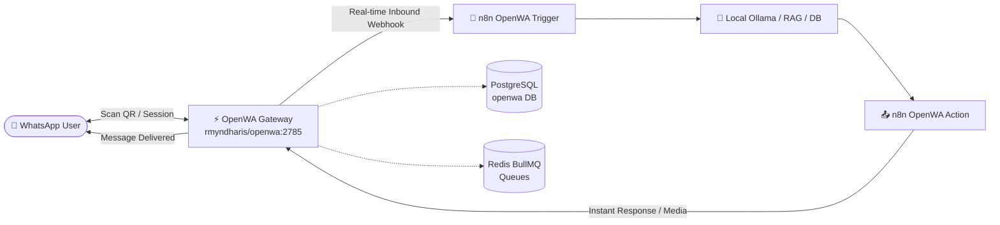

<div align="center">

# ⚡ AutomationKit

### The Production-Grade Local AI Orchestration & Microservices Cloud Stack

<p align="center">
  <a href="https://github.com/codeXparadise/AutomationKit/releases/tag/v1.1.0"></a>
  <a href="https://github.com/codeXparadise/AutomationKit/blob/main/LICENSE"></a>
  <a href="https://github.com/codeXparadise/AutomationKit"></a>
  <a href="https://github.com/codeXparadise/AutomationKit/stargazers"></a>
  <a href="https://github.com/codeXparadise/AutomationKit/issues"></a>
  <a href="https://github.com/codeXparadise/AutomationKit/pulls"></a>
</p>

<p align="center">
  <strong>AutomationKit</strong> is a turn-key, self-hosted developer platform that packages leading workflow automation, <strong>100% free WhatsApp automation (OpenWA)</strong>, local LLMs, vector search, web scraping, document OCR, graph databases, and caching into a unified Docker network orchestrated behind a smart Caddy gateway.
</p>

<p align="center">
  <a href="#-quickstart-guide">Quickstart</a> •
  <a href="#-100-free-whatsapp-automation-openwa"><strong>📱 Free WhatsApp Automation</strong></a> •
  <a href="docs/README.md"><strong>📚 n8n API Docs & Blueprints</strong></a> •
  <a href="#-architecture--networking">Architecture</a> •
  <a href="#-service-matrix--endpoints">Service Matrix</a> •
  <a href="#-n8n-node-integration-blueprints">n8n Blueprints</a> •
  <a href="#-local-swagger--api-docs">Swagger & API Docs</a> •
  <a href="#-credits--attributions"><strong>❤️ Credits & Attribution</strong></a> •
  <a href="CHANGELOG.md"><strong>📝 Changelog (v1.1.0)</strong></a> •
  <a href="#-contributing--license">Contributing</a>
</p>

---

</div>

## 🎬 Workflow Automation Demo

AutomationKit runs n8n natively integrated with local Ollama models, Qdrant vector retrieval, PostgreSQL state storage, and Crawl4AI scrapers:

<div align="center">
  
</div>

---

## 📱 100% Free WhatsApp Automation (OpenWA)

> **Automate your WhatsApp entirely for completely free!**  
> Say goodbye to expensive Cloud API fees, template approvals, monthly limits, and per-conversation charges. AutomationKit v1.1 embeds **OpenWA** alongside **n8n** so you can trigger workflows from incoming messages and send rich automated responses in real-time.



### ✨ What You Can Do
* **Zero Cost**: No Meta Business API fees, no monthly software subscriptions.
* **Instant Visual Webhooks**: Trigger n8n flows instantly on `message.received`, `session.status`, or `session.qr`.
* **Rich Interactions**: Send text, images, video, audio, voice notes, PDFs, location coordinates, interactive buttons, and group management calls.
* **Persistent & Multi-Session**: Connect multiple WhatsApp numbers simultaneously; all session tokens and chats persist across restarts in PostgreSQL and `./data/openwa/`.
* **High Throughput**: Backed by Redis BullMQ async queues ensuring zero dropped messages during traffic spikes.
* **Interactive Docs**: Complete Swagger UI documentation available at `http://openwa.local/api/docs` (or `http://localhost:2785/api/docs`).

---

## 🏛 Architecture & Networking

All 11 microservices run inside an isolated Docker bridge network (`automationkit`), proxied through the **AutomationKit** Caddy gateway. Local `.local` domains and native `.localhost` fallback domains provide instant browser access with zero SSL warnings or port gymnastics.

<div align="center">
  
</div>

### 🔑 Key Architectural Highlights
* **Zero-Collision Auto-Auth Gateway:** Caddy acts as the front door (`container_name: AutomationKit`), transparently injecting Bearer tokens to backend APIs (such as Crawl4AI Swagger & ReDoc) to eliminate `401 Unauthorized` prompts on direct browser navigation.
* **Persistent Data Separation:** Container states live under `./data/{service}`, persistent cross-container file shares live in `./shared`, and custom configurations reside in `./config`. Recreating containers never loses user workflows or databases.
* **External Task Runner Model:** n8n leverages dedicated task runners with pre-installed Python data science libraries (`pandas`, `numpy`, `yt-dlp`, `redis`, `requests`) isolated from the main orchestration engine.
* **Isolated DinD AI Sandbox Execution:** n8n Assistant executes generated Python/JS code securely inside Docker-in-Docker sandboxes (`sandbox-runner-1`) managed by a dedicated mTLS control plane API (`sandbox-api:8080`), preventing untrusted code from accessing host infrastructure.

---

## 🧰 The Technology Stack

| Technology | Role | Version | Official Documentation | Source Repository |
| :--- | :--- | :--- | :--- | :--- |
|  **n8n** | Workflow Automation & AI Agents | `v2.43.7` | [docs.n8n.io](https://docs.n8n.io/) | [](https://github.com/n8n-io/n8n) |
|  **OpenWA** | WhatsApp Gateway & Webhooks | `Latest` | [open-wa.org](https://open-wa.org/) | [](https://github.com/open-wa/wa-automate-nodejs) [](https://github.com/rmyndharis/openwa) |
|  **Crawl4AI** | Async Web Crawler & LLM Parser | `Latest` | [crawl4ai.com](https://crawl4ai.com/) | [](https://github.com/unclecode/crawl4ai) |
|  **Docling** | Document Parsing & PDF OCR | `Latest` | [ds4sd.github.io/docling](https://ds4sd.github.io/docling/) | [](https://github.com/DS4SD/docling) |
|  **Qdrant** | Vector Search Engine & RAG DB | `v1.19.2` | [qdrant.tech/documentation](https://qdrant.tech/documentation/) | [](https://github.com/qdrant/qdrant) |
|  **Ollama** | Local LLMs (Llama 3, Mistral, Qwen) | `Latest` | [ollama.com/library](https://ollama.com/library) | [](https://github.com/ollama/ollama) |
|  **SearXNG** | Private Metasearch Engine | `Latest` | [docs.searxng.org](https://docs.searxng.org/) | [](https://github.com/searxng/searxng) |
|  **Supabase** | PostgREST API, Auth & Storage Cluster | `Latest` | [supabase.com/docs](https://supabase.com/docs) | [](https://github.com/supabase/supabase) |
|  **Neo4j** | Graph Database & Knowledge Graphs | `5-community` | [neo4j.com/docs](https://neo4j.com/docs/) | [](https://github.com/neo4j/neo4j) |
|  **Redis & Insight** | In-Memory Cache & Visual GUI | `7-alpine` | [redis.io/docs](https://redis.io/docs/) | [](https://github.com/redis/redis) |
|  **PostgreSQL** | Relational SQL Storage | `16-alpine` | [postgresql.org/docs](https://www.postgresql.org/docs/16/) | [](https://github.com/postgres/postgres) |
|  **n8n Sandbox** | Isolated DinD Code Execution Sandbox | `v1.9.0` | [docs.n8n.io](https://docs.n8n.io/deploy/host-n8n/configure-n8n/set-up-n8n-assistant/) | [](https://github.com/n8n-io/n8n) |
|  **Caddy** | Reverse Proxy & Portal Gateway | `2-alpine` | [caddyserver.com/docs](https://caddyserver.com/docs/) | [](https://github.com/caddyserver/caddy) |

---

## 🚀 Quickstart Guide

### 1. Prerequisites
* **Docker & Docker Compose v2+**: Installed and running ([Docker Desktop](https://www.docker.com/products/docker-desktop/)).
* **Git**: Installed.
* **Operating System**: Windows (PowerShell/CMD), Linux, or macOS.

### 2. Clone the Repository
```bash
git clone https://github.com/codeXparadise/AutomationKit.git
cd AutomationKit
```

### 3. Configure Secrets (`.env`)
Copy the template configuration file:
```bash
# Windows (CMD)
copy .env.example .env

# Linux / macOS / PowerShell
cp .env.example .env
```
Open `.env` and set your preferred secrets. The default configured environment variables follow this structure:
* `POSTGRES_USER=${POSTGRES_USER:-admin}`
* `POSTGRES_PASSWORD=${POSTGRES_PASSWORD}`
* `REDIS_PASSWORD=${REDIS_PASSWORD}`
* `QDRANT_API_KEY=admin:${QDRANT_PASSWORD}`
* `CRAWL4AI_API_TOKEN=${CRAWL4AI_API_TOKEN}`
* `NEO4J_PASSWORD=${NEO4J_PASSWORD}`
* `DOCLING_API_KEY=${DOCLING_API_KEY}`
* `SANDBOX_API_KEYS=${SANDBOX_API_KEYS}`
* `SUPABASE_SERVICE_ROLE_KEY=${SUPABASE_SERVICE_ROLE_KEY}`

### 4. Setup Local DNS Domains (Windows)
Run the unified CLI script (or select Option `[6]`) to map `.local` domains into your Windows hosts file:
```cmd
automation.bat hosts
```
*(Optionally, `.localhost` works natively in modern browsers without any host configuration).*


### 5. Launch AutomationKit
Start the entire stack using the unified control CLI:
```cmd
automation.bat start
```
Or directly via Docker Compose:
```bash
docker compose pull
docker compose up -d
```

### 6. Launch the Master Hub Portal
Once running, double-click **`automation.bat`** (Option `[4]`), run `automation.bat open`, or navigate to:
👉 **[http://localhost](http://localhost)** *(or [http://hub.local](http://hub.local))*

---

## 📊 Service Matrix & Endpoints

| Service | Browser Access (`.local` / Host) | Fallback (`.localhost`) | Docker Internal Host | Default Credentials |
| :--- | :--- | :--- | :--- | :--- |
|  **AutomationKit Hub** | `http://localhost` / `http://hub.local` | `http://hub.localhost` | `caddy:80` | None |
|  **n8n Automation** | `http://n8n.local` / `http://localhost:5678` | `http://n8n.localhost` | `n8n:5678` | Self-register owner on first boot |
|  **Supabase Studio** | `http://supabase.local` / `http://localhost:54323` | `http://supabase.localhost` | `supabase-studio:3000` | Kong API: `8000`, DB: `5432` |
|  **Redis Insight** | `http://radis.local` / `http://localhost:5540` | `http://redis.localhost` | `redisinsight:5540` | Host: `redis`, Port: `6379`, Pass: `${REDIS_PASSWORD}` |
|  **Crawl4AI Playground** | `http://crawl.local/playground/` | `http://crawl.localhost/playground/` | `crawl4ai:11235` | Bearer Token: `${CRAWL4AI_API_TOKEN}` |
|  **Qdrant Dashboard** | `http://qdrant.local` / `http://localhost:6333/dashboard` | `http://qdrant.localhost` | `qdrant:6333` | API Key: `admin:${QDRANT_PASSWORD}` |
|  **Neo4j Browser** | `http://neo.local` / `http://localhost:7474` | `http://neo.localhost` | `bolt://neo4j:7687` | User: `neo4j`, Password: `${NEO4J_PASSWORD}` |
|  **SearXNG Search** | `http://search.local` / `http://localhost:8080` | `http://search.localhost` | `searxng:8080` | None (Open) |
|  **Docling Parser UI** | `http://docling.local` / `http://localhost:5001/ui` | `http://docling.localhost` | `docling:5001` | API Key: `${DOCLING_API_KEY}` |
|  **Assistant Sandbox API** | `http://sandbox.local` / `http://localhost:5681` | `http://sandbox.localhost` | `sandbox-api:8080` | Header: `X-Api-Key: ${SANDBOX_API_KEYS}` |
|  **Ollama Local LLM** | `http://ollama.local` / `http://localhost:11434` | `http://ollama.localhost` | `ollama:11434` | None (Open) |
|  **PostgreSQL DB** | `localhost:5432` *(External SQL clients)* | N/A | `postgres:5432` | User: `admin`, Pass: `${POSTGRES_PASSWORD}`, DB: `n8n_database` |
|  **Redis Store** | `localhost:6379` *(External Redis clients)* | N/A | `redis:6379` | Password: `${REDIS_PASSWORD}` |
|  **OpenWA Gateway** | `http://openwa.local` / `http://localhost:2785` | `http://openwa.localhost` | `openwa:2785` | Header: `X-API-Key: ${OPENWA_API_KEY}` |
|  **Shared Volume** | `http://files.local` | `http://files.localhost` | Mount: `/data/shared` | Local folder: `./shared` |

---

## ⚡ n8n Node Integration Blueprints

When building workflows inside n8n, use these connection parameters in your node credentials:

### 1. PostgreSQL Node
* **Host:** `postgres`
* **Port:** `5432`
* **Database:** `n8n_database`
* **User:** `${POSTGRES_USER:-admin}`
* **Password:** `${POSTGRES_PASSWORD}`
* **SSL:** `disable`

### 2. Redis Node
* **Host:** `redis`
* **Port:** `6379`
* **Password:** `${REDIS_PASSWORD}`
* **SSL:** `false`

### 3. Qdrant Vector Store Node
* **Qdrant API URL:** `http://qdrant:6333`
* **API Key:** `admin:${QDRANT_PASSWORD}`

### 4. Neo4j Graph Database Node
* **Bolt URL:** `bolt://neo4j:7687`
* **Username:** `neo4j`
* **Password:** `${NEO4J_PASSWORD}`

### 5. Crawl4AI (HTTP Request Node)
* **Method:** `POST`
* **URL:** `http://crawl4ai:11235/crawl`
* **Headers:**
  * `Authorization`: `Bearer ${CRAWL4AI_API_TOKEN}`
  * `Content-Type`: `application/json`
* **JSON Body:**
```json
{
  "urls": ["https://example.com"],
  "crawler_config": {
    "cache_mode": "BYPASS"
  }
}
```

### 6. SearXNG Search (HTTP Request Node)
* **Method:** `GET`
* **URL:** `http://searxng:8080/search`
* **Query Parameters:**
  * `q`: `{{$json.query}}`
  * `format`: `json`

### 7. Ollama Chat & Model Node
* **Base URL:** `http://ollama:11434`
* **Model Name:** `llama3.2` *(pull via `docker exec -it ollama ollama run llama3.2`)*

### 8. OpenWA WhatsApp Gateway Node
* **OpenWA Credential (`OpenWaApi`):**
  * **Base URL:** `http://openwa:2785` *(or `http://localhost:2785`)*
  * **API Key:** `${OPENWA_API_KEY}`
* **Inbound Trigger (`OpenWaTrigger` Node):**
  * **Session Name:** `default` *(or your registered session name)*
  * **Events:** `message.received` *(or all events)*
  * **Webhook Registration:** Handled automatically by n8n when workflow is activated!
* **Outbound Action (`OpenWa` Node):**
  * **Operation:** Send Text, Send Image/Video, Send Document, Buttons, or Manage Groups
  * **Chat ID:** `[phone_number]@c.us` (e.g. `918433696619@c.us`)

### 9. n8n Assistant Sandbox Execution Integration
* **Sandbox Provider:** `n8n-sandbox`
* **Sandbox Service URL:** `http://sandbox-api:8080` (or `http://sandbox.local`)
* **API Key:** `${SANDBOX_API_KEYS}` (Header: `X-Api-Key: ${SANDBOX_API_KEYS}`)
* **Runner Registration Token:** `${SANDBOX_RUNNER_REGISTRATION_TOKEN}`
* **Runner Control API Key:** `${SANDBOX_API_RUNNER_API_KEY}`
* **Sandbox Container Image:** `ghcr.io/n8n-io/n8n-sandbox-service-sandbox:1.9.0`
* **Direct REST API Endpoints:**
  * **Health Status:** `GET http://localhost:5681/healthz`
  * **List Active Sandboxes:** `GET http://localhost:5681/sandboxes` (Header: `X-Api-Key: ${SANDBOX_API_KEYS}`)
  * **Spawn Ephemeral Sandbox:** `POST http://localhost:5681/sandboxes` (Header: `X-Api-Key: ${SANDBOX_API_KEYS}`, Body: `{}`)
  * **Terminate Sandbox:** `DELETE http://localhost:5681/sandboxes/{id}` (Header: `X-Api-Key: ${SANDBOX_API_KEYS}`)

---

## 📖 Local Swagger & API Docs

AutomationKit features built-in, local Swagger and interactive API documentation running inside your containers:

*  **OpenWA WhatsApp API Swagger UI:** [http://localhost:2785/api/docs](http://localhost:2785/api/docs) *(or [http://openwa.local/api/docs](http://openwa.local/api/docs))*
*  **Crawl4AI Swagger UI:** [http://localhost:11235/docs](http://localhost:11235/docs) *(Auto-authenticated)*
*  **Crawl4AI ReDoc:** [http://localhost:11235/redoc](http://localhost:11235/redoc)
*  **Docling Swagger UI:** [http://localhost:5001/docs](http://localhost:5001/docs)
*  **Qdrant REST Console:** [http://localhost:6333/dashboard#/console](http://localhost:6333/dashboard#/console)
*  **Ollama Installed Models:** [http://localhost:11434/api/tags](http://localhost:11434/api/tags)
*  **SearXNG Settings & JSON API:** [http://localhost:8080/preferences](http://localhost:8080/preferences)
*  **n8n Assistant Sandbox API:** [http://localhost:5681/healthz](http://localhost:5681/healthz) | Sandboxes: [http://localhost:5681/sandboxes](http://localhost:5681/sandboxes) *(Header: `X-Api-Key: ${SANDBOX_API_KEYS}`)*

---

## 🛠 Unified Control CLI Reference

AutomationKit provides a single, consolidated control script **`automation.bat`** (or `automation.sh` for Linux) for zero-friction management:

```bash
# Interactive menu (or double-click automation.bat)
automation.bat

# Direct commands
automation.bat start            # Pull images and start all 24+ containers
automation.bat stop             # Safely shut down all containers
automation.bat restart          # Restart stack
automation.bat open             # Open Web Control Center (http://localhost)
automation.bat docs             # Open Knowledge Hub & Docs (http://localhost/docs.html)
automation.bat hosts            # Configure .local DNS domains in Windows hosts
automation.bat status           # View live container status table
automation.bat logs [service]   # Tail live container logs
automation.bat reset-n8n        # Reset n8n owner credentials
```

---

## ❓ Troubleshooting & FAQs

<details>
<summary><strong>1. How do I reset my n8n owner password?</strong></summary>

If you forget your credentials for n8n, run:
```bash
docker exec -it n8n n8n user-management:reset
```
Follow the interactive prompt to enter a new email and password.
</details>

<details>
<summary><strong>2. Why are <code>.local</code> domains not opening?</strong></summary>

Windows requires `.local` domain entries in `C:\Windows\System32\drivers\etc\hosts`. 
Simply right-click and run **`setup-hosts.bat`** as Administrator. 
Alternatively, use the native `.localhost` domains (e.g. `http://n8n.localhost`, `http://crawl.localhost`) which modern browsers resolve automatically without any hosts configuration.
</details>

<details>
<summary><strong>3. How do I download LLM models into Ollama?</strong></summary>

Execute the model pull command inside the container:
```bash
docker exec -it ollama ollama run llama3.2
docker exec -it ollama ollama run mistral
docker exec -it ollama ollama run nomic-embed-text
```
</details>

<details>
<summary><strong>4. How do I install extra Python libraries in n8n Code nodes?</strong></summary>

Edit `services/runner/Dockerfile` and add your required packages via `pip install`, then rebuild the runner container:
```bash
docker compose up -d --build task-runners
```
</details>

<details>
<summary><strong>5. How does the n8n Assistant Sandbox work and how is it secured?</strong></summary>

AutomationKit includes the official n8n Assistant Sandbox stack consisting of three coordinated microservices:
1. **`sandbox-certs`**: Ephemeral init service generating mTLS certificates (`bootstrap-mtls.sh`) into a shared Docker volume (`sandbox-tls`).
2. **`sandbox-api`**: FastAPI/Go control plane listening on internal port `8080` (mapped to `5681`) that tracks sandbox state and exposes REST endpoints. Authenticates incoming n8n requests via `SANDBOX_API_KEYS` (`X-Api-Key`), and communicates with runners using `SANDBOX_API_RUNNER_API_KEY`.
3. **`sandbox-runner-1`**: Privileged Docker-in-Docker (`dind`) daemon with gRPC mTLS control server on port `9091` that pulls and spins up isolated `n8n-sandbox-service-sandbox:1.9.0` micro-containers on demand.

If you ever encounter an `rpc error: code = Unauthenticated desc = missing x-api-key` in `sandbox-api`, ensure `SANDBOX_API_RUNNER_API_KEY` is present in `compose.yml` matching `SANDBOX_RUNNER_API_KEYS` in `sandbox-runner-1`.
</details>

---

## ❤️ Credits & Attributions

AutomationKit is made possible by the incredible open-source community. Deep gratitude and all credits go to the original creators and maintainers of these foundational projects:

| Project | Original Creator / Maintainer | Description & Role | Official Repository |
| :--- | :--- | :--- | :--- |
| **n8n** | [Jan Oberhauser](https://github.com/janober) & [n8n.io](https://github.com/n8n-io) | Leading fair-code workflow automation and AI agent orchestrator | [](https://github.com/n8n-io/n8n) |
| **OpenWA** | [Mohammed Shah](https://github.com/smashah) & [rmyndharis](https://github.com/rmyndharis) | 100% Free WhatsApp Web automation client, API gateway & n8n nodes | [](https://github.com/open-wa/wa-automate-nodejs) [](https://github.com/rmyndharis/openwa) [](https://github.com/rmyndharis/n8n-nodes-openwa) |
| **Crawl4AI** | [UncleCode](https://github.com/unclecode) | High-performance open-source asynchronous LLM web crawler and scraper | [](https://github.com/unclecode/crawl4ai) |
| **Docling** | [IBM Research / DS4SD Team](https://github.com/DS4SD) | Advanced PDF and multi-format document parser, OCR & Markdown extractor | [](https://github.com/DS4SD/docling) |
| **Qdrant** | [Qdrant Team](https://github.com/qdrant) | High-scale, lightning-fast vector database & similarity search engine for RAG | [](https://github.com/qdrant/qdrant) |
| **Ollama** | [Jeffrey Morgan](https://github.com/jmorganca) & [Ollama Team](https://github.com/ollama) | Frictionless local execution engine for open-weights LLMs (Llama 3, Mistral, Qwen) | [](https://github.com/ollama/ollama) |
| **SearXNG** | [SearXNG Community](https://github.com/searxng) | Free, private, self-hosted metasearch engine protecting user queries | [](https://github.com/searxng/searxng) |
| **Supabase** | [Paul Copplestone](https://github.com/kiwicopple), [Ant Wilson](https://github.com/awalias) & [Supabase Team](https://github.com/supabase) | Open-source Firebase alternative featuring PostgREST, Auth, and Storage | [](https://github.com/supabase/supabase) |
| **Neo4j** | [Emil Eifrem](https://github.com/emileifrem) & [Neo4j Community](https://github.com/neo4j) | The world's leading native graph database engine and Cypher query processor | [](https://github.com/neo4j/neo4j) |
| **Redis** | [Salvatore Sanfilippo (antirez)](https://github.com/antirez) & [Redis Community](https://github.com/redis) | In-memory data structure store, high-speed cache, and message queue broker | [](https://github.com/redis/redis) |
| **PostgreSQL** | [PostgreSQL Global Development Group](https://www.postgresql.org/) | World's most advanced enterprise-grade open-source relational database | [](https://github.com/postgres/postgres) |
| **Caddy** | [Matthew Holt](https://github.com/mholt) & [Caddy Community](https://github.com/caddyserver) | Enterprise-grade, modern HTTP/2 & HTTP/3 reverse proxy with automatic local HTTPS | [](https://github.com/caddyserver/caddy) |

Please consider supporting, starring, and sponsoring these projects!

---

## 🤝 Contributing & License

Contributions, issues, and feature requests are welcome!
* Read our [Code of Conduct](CODE_OF_CONDUCT.md).
* Report bugs or request features at [GitHub Issues](https://github.com/codeXparadise/AutomationKit/issues).

### License
Distributed under the **MIT License**. See [`LICENSE`](LICENSE) for details.

---

<div align="center">
  <sub>Maintained with ❤️ by <a href="https://github.com/codeXparadise">codeXparadise</a> &bull; AutomationKit</sub>
</div>
