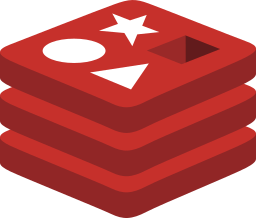

<div align="center">
  
  <h1>Automation Stack — n8n Tools & API Integration Hub</h1>
  <p><strong>Complete Integration Reference for Local AI & Microservices</strong></p>
</div>

Welcome to the comprehensive API and n8n integration documentation for the **Automation** platform. Every microservice in this stack is pre-configured on an internal Docker bridge network (`Automation`), enabling zero-latency, secure, container-to-container communication.

> [!TIP]
> **Dynamic Environment Resolution:** All API keys and secrets in this documentation use `.env` placeholders (e.g. `${DOCLING_API_KEY}`, `${CRAWL4AI_API_KEY}`). When viewed inside the AutomationKit Console or imported through n8n, these values are dynamically resolved from your local `.env`. When committing to GitHub, your secrets remain 100% protected.

---

## ⚡ The Golden Rule for n8n in Docker

> [!CAUTION]
> **NEVER use `localhost` or `127.0.0.1` inside n8n when calling other stack tools!**  
> Since n8n runs inside its own Docker container, `localhost` points strictly to the n8n container itself, resulting in `ECONNREFUSED`.  
> **Always use the Docker internal service name and internal port** (e.g. `http://docling:5001`, `http://crawl4ai:11235`, `http://ollama:11434`).

---

## Quick Reference & Connection Matrix

| Tool | Purpose | Docker Internal URL (Use in n8n) | Host URL (Browser/Postman) | Authentication | Documentation |
| :--- | :--- | :--- | :--- | :--- | :--- |
|  **Docling** | OCR, PDF & Document Parser | `http://docling:5001` | `http://localhost:5001` | Header `X-API-Key: ${DOCLING_API_KEY}` | [Docling Guide](docling.md) |
|  **Crawl4AI** | Playwright Web Scraper & Crawler | `http://crawl4ai:11235` | `http://localhost:11235` | Header `Authorization: Bearer ${CRAWL4AI_API_KEY}` | [Crawl4AI Guide](crawl4ai.md) |
|  **Ollama** | Local LLM & Embeddings | `http://ollama:11434` | `http://localhost:11434` | None (Open) | [Ollama Guide](ollama.md) |
|  **Qdrant** | Vector Search Engine & Storage | `http://qdrant:6333` | `http://localhost:6333` | Header `api-key: admin:${QDRANT_PASSWORD}` | [Qdrant Guide](qdrant.md) |
|  **SearXNG** | Privacy Meta Search API | `http://searxng:8080` | `http://searxng:8080` | None (Open) | [SearXNG Guide](searxng.md) |
|  **Supabase** | PostgREST, Auth & S3 Storage | `http://kong:8000` | `http://localhost:54321` | Headers `apikey` & `Authorization: Bearer ${SUPABASE_SERVICE_ROLE_KEY}` | [Supabase Guide](supabase.md) |
|  **Neo4j** | Graph Database & Cypher API | `http://neo4j:7474` (HTTP)<br>`bolt://neo4j:7687` | `http://localhost:7474` | Basic Auth: `neo4j` / `${NEO4J_PASSWORD}` | [Neo4j Guide](neo4j.md) |
|  **Redis** | In-Memory Cache & Key-Value | `redis:6379` | `localhost:6379` | Password: `${REDIS_PASSWORD}` | [Redis Guide](redis.md) |
|  **PostgreSQL**| Relational Database | `postgres:5432` | `localhost:5432` | User: `admin`, Pass: `${POSTGRES_PASSWORD}`, DB: `n8n_database` | [PostgreSQL Guide](postgres.md) |
|  **OpenWA** | 100% Free WhatsApp API Gateway | `http://openwa:2785` | `http://localhost:2785` | Header `X-API-Key: ${OPENWA_API_KEY}` | [OpenWA Guide](openwa.md) |
|  **Sandbox API**| Isolated Code Execution Runner | `http://sandbox-api:8080` | `http://localhost:5681` | Header `X-API-Key: ${SANDBOX_API_KEYS}` | [Sandbox Guide](sandbox.md) |

---

## Table of Contents

- [1. Universal n8n Setup Best Practices](#1-universal-n8n-setup-best-practices)
  - [1.1 Creating Reusable Credentials in n8n](#11-creating-reusable-credentials-in-n8n)
  - [1.2 Using the Generic HTTP Request Node](#12-using-the-generic-http-request-node)
  - [1.3 Error Handling & Timeouts for AI Workflows](#13-error-handling--timeouts-for-ai-workflows)
- [2. Individual Tool Guides](#2-individual-tool-guides)
- [3. Common Troubleshooting & Error Codes](#3-common-troubleshooting--error-codes)

---

## 1. Universal n8n Setup Best Practices

### 1.1 Creating Reusable Credentials in n8n

Instead of typing API keys in every HTTP Request node:
1. In n8n, open the left sidebar and click **Credentials** → **Add Credential**.
2. Select **Header Auth**.
3. Name it according to the service (e.g. `Docling Auth` or `Crawl4AI Auth`).
4. Enter the required Header Name and Value:
   - For Docling: Name = `X-API-Key`, Value = `${DOCLING_API_KEY}`
   - For Crawl4AI: Name = `Authorization`, Value = `Bearer ${CRAWL4AI_API_KEY}`
   - For Qdrant: Name = `api-key`, Value = `admin:${QDRANT_PASSWORD}`
5. Click **Save**. Now you can select this credential in any HTTP Request node with one click.
5. Click **Save**. Now you can select this credential in any HTTP Request node with one click.

### 1.2 Using the Generic HTTP Request Node

When interacting with any REST API endpoint:
1. Drag the **HTTP Request** node into your canvas.
2. In **Authentication**, select **Predefined Credential Type** → **Header Auth** (or your saved credential).
3. Set the **URL** using the container internal hostname:
   ```
   http://<service-name>:<internal-port>/<endpoint>
   ```
4. Set **Send Body** to `true` (for POST/PUT requests), select **Body Content Type** → `JSON`, and paste the payload into **Specify Body** → `Using JSON`.

### 1.3 Error Handling & Timeouts for AI Workflows

AI services (such as Docling parsing a 50-page PDF, or Ollama generating a response with large context) may take 15 to 60 seconds.
- In the n8n HTTP Request node:
  - Scroll down to **Settings** (or **Options**).
  - Add **Timeout**: Set to `120000` (120 seconds).
  - Add **Never Error**: Useful if you want to branch on error conditions rather than failing the entire execution.

---

## 2. Individual Tool Guides

Click any tool below for dedicated, step-by-step documentation with sidebars, curl snippets, and ready-to-import n8n workflow templates:

- 📄 **[Docling Documentation](docling.md)** — Parse PDFs, scanned documents, DOCX, and images into structured Markdown or JSON.
- 🕷️ **[Crawl4AI Documentation](crawl4ai.md)** — Scrape dynamic websites, execute JavaScript, take screenshots, and extract clean LLM-ready markdown.
- 🦙 **[Ollama Documentation](ollama.md)** — Run local LLMs (`llama3`, `mistral`, `deepseek`, etc.) and embeddings with native AI Agent support.
- 🔍 **[SearXNG Documentation](searxng.md)** — Integrate private, multi-engine web search directly into your AI workflows without API fees.
- ⚡ **[Qdrant Documentation](qdrant.md)** — High-performance vector database for RAG (Retrieval-Augmented Generation) and semantic search.
- ⚡ **[Supabase Documentation](supabase.md)** — Complete backend with PostgREST database CRUD, Authentication, and S3-compatible file storage.
- 🕸️ **[Neo4j Documentation](neo4j.md)** — Knowledge graph operations, relationship analysis, and Cypher query execution via HTTP & Bolt.
- 🟥 **[Redis Documentation](redis.md)** — Fast caching, rate-limiting, temporary memory, and task queues in n8n.
- 🐘 **[PostgreSQL Documentation](postgres.md)** — Relational data storage, automated transactions, and complex SQL data transformations.
- 📱 **[OpenWA Documentation](openwa.md)** — 100% Free self-hosted WhatsApp automation gateway, visual webhooks, and n8n community nodes.
- 📦 **[Sandbox Runner Documentation](sandbox.md)** — Isolated DinD micro-runners for custom Python and Node.js execution inside n8n.

---

## 3. Common Troubleshooting & Error Codes

| Error Symptom | Cause | Solution |
| :--- | :--- | :--- |
| `ECONNREFUSED 127.0.0.1:<port>` | Node configured with `localhost` | Change `localhost` to the container service name (e.g. `docling`, `crawl4ai`). |
| `401 Unauthorized` | Missing or incorrect API key / Bearer token | Check the **Authentication** section in the tool's guide. Verify credentials in your `.env`. |
| `ETIMEDOUT` | Heavy processing or model download in progress | Increase the **Timeout** in node Options to `180000` (3 minutes). |
| `422 Unprocessable Entity` | Malformed JSON payload or missing required field | Inspect the JSON snippet in the specific tool guide to verify schema. |
